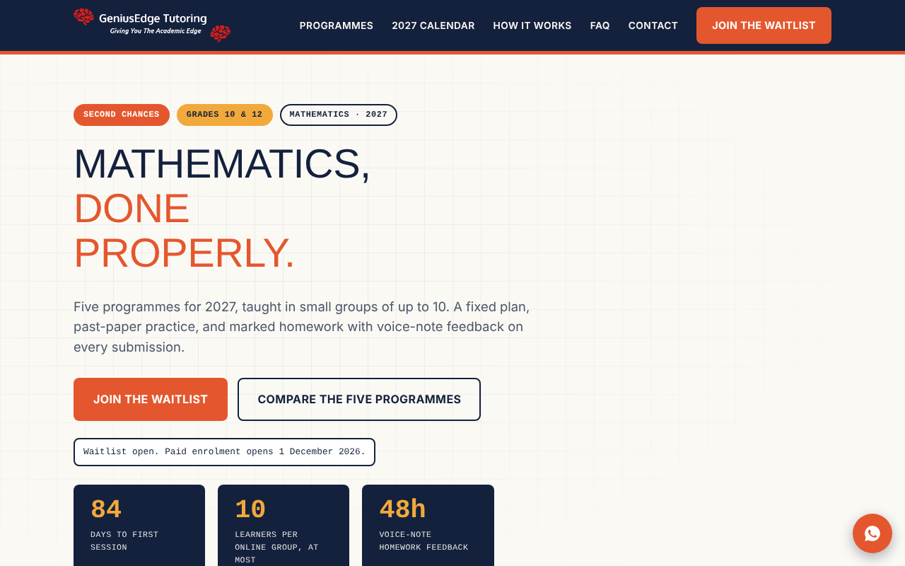
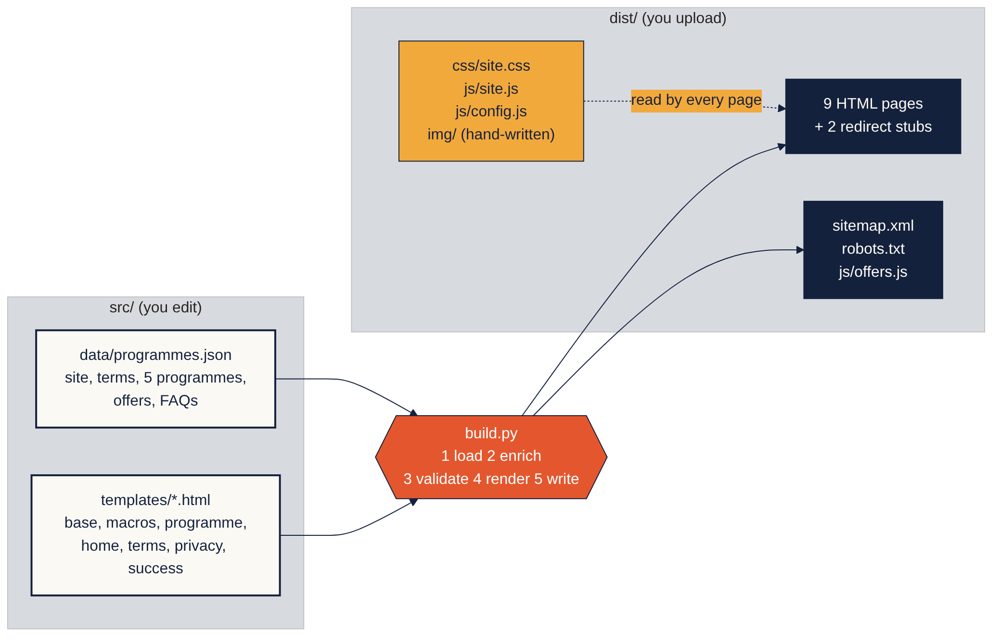
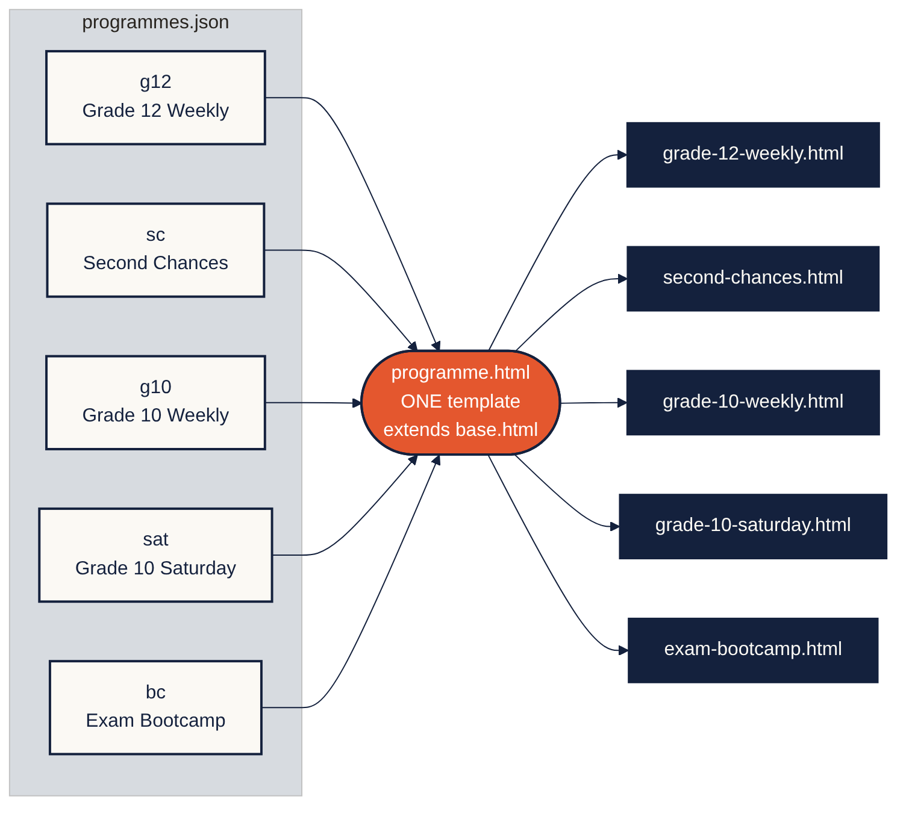
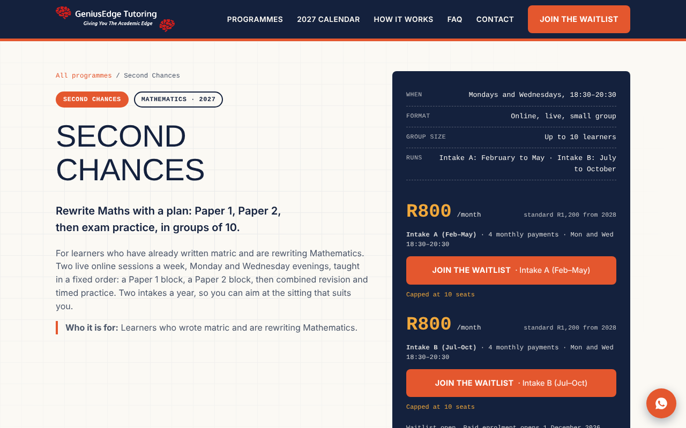
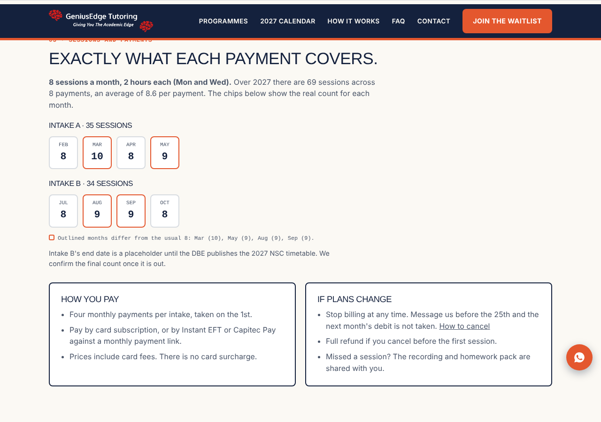
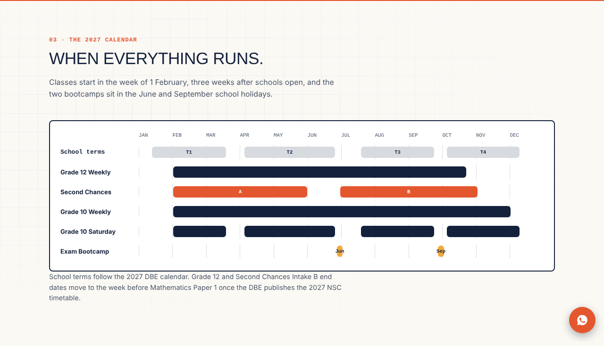
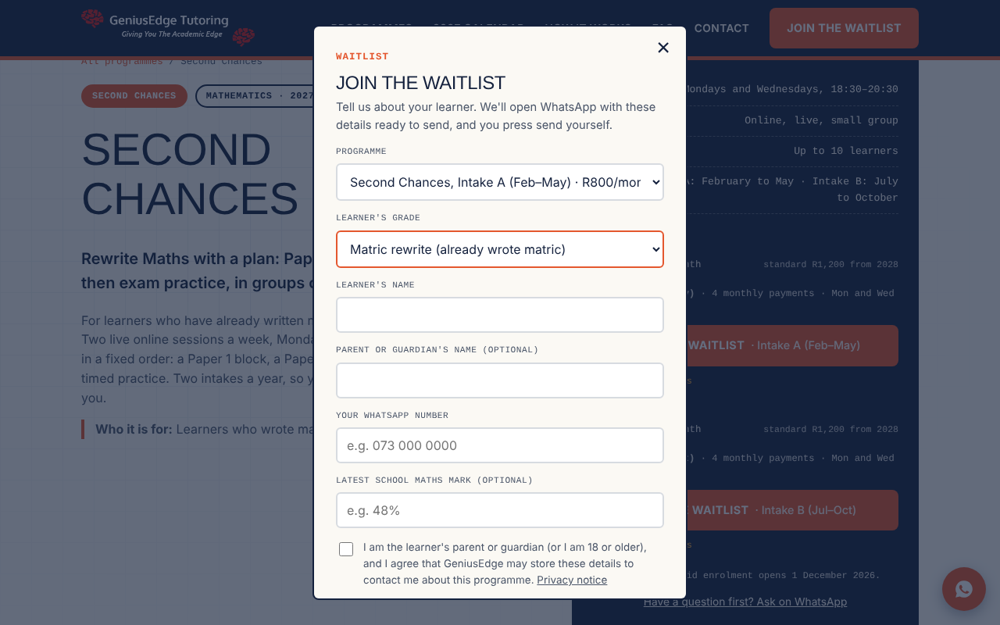
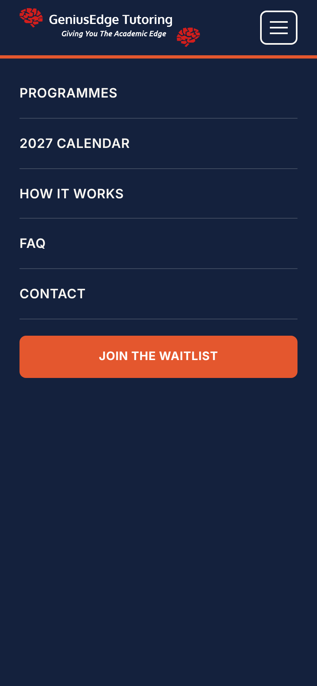
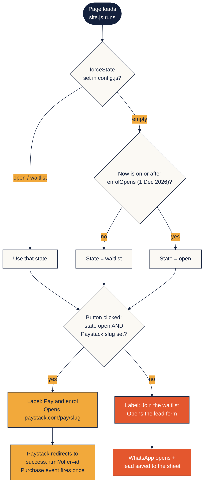
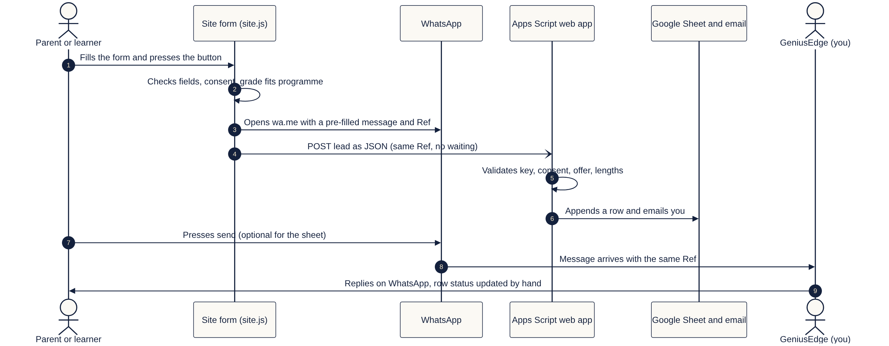

# GeniusEdge website

The 2027 website for **GeniusEdge Tutoring**, small-group Mathematics tutoring for Grade 10, Grade 12 and matric rewrite learners in South Africa.

It is a **static site**: a short Python script combines one data file with a set of HTML templates and writes plain HTML pages. There is no server, database or framework at run time. You upload the generated `dist/` folder to ordinary web hosting.



*The home page. Screenshots in this README were taken in a sandbox without access to Google Fonts, so headings show a fallback font. The live site uses Archivo Black, Inter and Space Mono.*

---

## Contents

1. [Quick start](#1-quick-start)
2. [How the site is built](#2-how-the-site-is-built)
3. [Project structure](#3-project-structure)
4. [The data file](#4-the-data-file)
5. [Templates](#5-templates)
6. [How the pages look](#6-how-the-pages-look)
7. [Behaviour in the browser](#7-behaviour-in-the-browser)
8. [Lead capture](#8-lead-capture)
9. [Configuration](#9-configuration)
10. [Deploying](#10-deploying)
11. [Testing](#11-testing)
12. [Security, SEO and accessibility](#12-security-seo-and-accessibility)
13. [Common tasks](#13-common-tasks)
14. [Open decisions and known gaps](#14-open-decisions-and-known-gaps)

---

## 1. Quick start

You need Python 3 and one package.

```bash
pip install jinja2
python3 build.py                       # writes everything into dist/
python3 -m http.server -d dist         # preview at http://localhost:8000
```

The build prints a one-line summary per programme (sessions, payments, average, months that differ), for example:

```
Second Chances        69 sessions / 8 payments = 8.6 avg; off-months: Mar (10), May (9), Aug (9), Sep (9)
```

If a session total does not match the agreed figure, the build stops with an error and writes nothing wrong.

**The one rule:** edit files in `src/` (and the three hand-written files in `dist/` listed below), then rebuild. Never edit a generated `.html` file in `dist/`; the next build overwrites it.

---

## 2. How the site is built

Every page is the result of one equation:

```
DATA (programmes.json) + TEMPLATE (*.html) + LOGIC (build.py) = PAGES (dist/*.html)
```



*What goes in, what the build does, and what comes out.*

`build.py` works in five steps:

| Step | What happens |
| --- | --- |
| 1. Load | Reads `src/data/programmes.json` into a Python dictionary |
| 2. Enrich | Calculates values the templates need: price text, sessions per month, intake totals, the year timeline |
| 3. Validate | Stops with an error if a programme's yearly session count differs from the agreed total (38, 69, 44, 34) |
| 4. Render | Fills each Jinja2 template with the data, with HTML autoescaping switched on |
| 5. Write | Saves pages, `sitemap.xml`, `robots.txt` and `js/offers.js` into `dist/` |

### One template, five programme pages

The five programme pages are not five files. They are one template, `programme.html`, rendered once for each programme in the data file. Optional sections (the running-order blocks, the compliance line, the bootcamp run cards, the two-intake buttons) appear only for programmes whose data includes them.



*Fix a layout problem once and it is fixed on every programme page.*

---

## 3. Project structure

```
geniusedge-site/
├── build.py                    the generator (about 190 lines)
├── README.md                   this file
├── apps-script/
│   ├── Code.gs                 Google Apps Script that saves leads to a sheet
│   └── SETUP.md                10-minute setup steps
├── docs/
│   ├── img/                    screenshots and diagrams used in this README
│   └── diagrams/               Mermaid sources for the diagrams
├── src/                        EDIT THESE
│   ├── data/
│   │   └── programmes.json     site info, school terms, 5 programmes, offers, FAQs
│   └── templates/
│       ├── base.html           page shell: head, header, footer, enrol form
│       ├── macros.html         reusable pieces: tag, price block, FAQ
│       ├── programme.html      the ONE template for all five programme pages
│       ├── home.html           home page
│       ├── terms.html          terms and policies
│       ├── privacy.html        privacy notice (POPIA)
│       └── success.html        thank-you page after payment
└── dist/                       UPLOAD THIS
    ├── index.html                  generated
    ├── grade-12-weekly.html        generated from programme.html
    ├── second-chances.html         generated from programme.html
    ├── grade-10-weekly.html        generated from programme.html
    ├── grade-10-saturday.html      generated from programme.html
    ├── exam-bootcamp.html          generated from programme.html
    ├── terms.html, privacy.html    generated
    ├── success.html                generated, set to noindex
    ├── faq.html, services.html     generated redirect stubs for old links
    ├── sitemap.xml, robots.txt     generated
    ├── css/site.css                HAND-WRITTEN: all styling
    ├── js/site.js                  HAND-WRITTEN: all behaviour
    ├── js/config.js                HAND-WRITTEN: settings you edit after upload
    ├── js/offers.js                generated: offers list for the browser
    └── img/                        logo.png (white wordmark) and favicon.png
```

| File | Written by | Edit it when |
| --- | --- | --- |
| `programmes.json` | You | A price, day, time, FAQ or date changes |
| `*.html` in `src/templates` | You | The layout or wording of a page type changes |
| `build.py` | You | You need a new page type or a new calculated field |
| `site.css`, `site.js`, `config.js` | You | Look, behaviour or settings change |
| `offers.js` and every `.html` in `dist/` | `build.py` | Never. Rebuild instead |

---

## 4. The data file

`src/data/programmes.json` is the single source of truth for content. It has four top-level keys.

| Key | Contains | Used for |
| --- | --- | --- |
| `site` | Name, legal name, domain, email, phone, WhatsApp number, area, address | Footer, contact links, structured data, canonical addresses |
| `terms` | The four 2027 DBE school terms | Session counting and the timeline bars |
| `programmes` | Five programme records | Every programme page, the home cards, the browser's offers list |
| `generalFaq` | Question and answer pairs | The home page FAQ |

A programme record holds its name, pitch, schedule, group size and billing, plus one or more **offers**. An offer is something a parent can buy, with its own price, id and Paystack page. Second Chances has two offers (Intake A and B) and the Exam Bootcamp has two (June and September runs).

Each weekly programme carries a `rule` (weekdays, date ranges, term-only or not). `build.py` walks every day in those ranges and counts sessions per month, which is how each page shows exactly what each payment covers.

Current offers and founding rates:

| Programme | Offer ids | When | Cap | Price |
| --- | --- | --- | --- | --- |
| Grade 12 Weekly | `g12` | Thursdays 18:30 to 20:30, online | 10 | R600 a month |
| Second Chances | `sc-a`, `sc-b` | Mondays and Wednesdays 18:30 to 20:30, online | 10 | R800 a month |
| Grade 10 Weekly | `g10` | Tuesdays, online | 10 | R550 a month |
| Grade 10 Saturday Class | `sat` | Saturdays 09:00 to 11:30, in person | 15 | R600 a month |
| Exam Bootcamp | `bc-jun`, `bc-sep` | Two one-week runs | 20 | R500 early bird, R800 standard |

---

## 5. Templates

The templates use [Jinja2](https://jinja.palletsprojects.com/). Four ideas cover almost everything in them:

- `{{ value }}` prints a value (HTML-escaped).
- `` repeats a block, which is how cards, chips and FAQ items are made.
- `` shows a section only when it applies.
- `` and `` let every page share one header, footer and form.

| Template | Job |
| --- | --- |
| `base.html` | Head and meta tags, masthead and menu, footer, WhatsApp button, the enrol form (a dialog) and the script tags |
| `macros.html` | Reusable snippets: `tag`, `price_block`, `faq` (a native `details` accordion) |
| `programme.html` | Hero, ticket card with prices and buttons, what you get, optional running order, sessions and payments chips, pay cards, FAQ, related programmes, closing call to action, mobile sticky bar |
| `home.html` | Hero with countdown, programme finder, five cards, promise bar, year timeline, how it works, FAQ, contact band |
| `terms.html`, `privacy.html` | Policies. Name, phone and email come from the data file, so they cannot disagree with the footer |
| `success.html` | Confirmation page that `site.js` personalises from `?offer=` and uses to fire the purchase event |

---

## 6. How the pages look

The visual design follows the GeniusEdge brand: Ink Navy `#14213D`, Paper `#FBF9F4`, Amber `#F2A93B`, Coral `#E4572E`, Grid Grey `#D7DBE0` and Ink Soft `#4A5568`, with a graph-paper background, a navy masthead with a coral rule, and 6 to 10 px corners. All colours are custom properties at the top of `site.css`, so a brand change is one edit.

### Programme cards on the home page


### A programme page: the ticket card

The card on the right holds the schedule, price and one button per offer. It stays in view while scrolling on desktop.



### Sessions and payments

Every month is a chip showing the real number of sessions. An outlined chip is a month that differs from the usual count. This is generated from the date rules, not typed.



### The 2027 calendar

Bars are positioned as percentages of the year, calculated in `build.py` from the DBE terms and programme dates.



### The enrol form

One form serves every button. It checks that the learner's grade fits the programme, and for Second Chances and matric rewrite learners the parent fields are optional because most are over 18.



### On a phone

Under 900 px the menu becomes a full-screen panel and a sticky bar with the price and main button sits at the bottom.

| Programme page | Menu open |
| --- | --- |
|  |  |

---

## 7. Behaviour in the browser

All behaviour is in `dist/js/site.js` (vanilla JavaScript in one function, no dependencies). The generator decides what is on the page; JavaScript handles what is only known when someone visits: today's date, which button was pressed, a form.



*How a button decides between "Join the waitlist" and "Pay & enrol".*

| Feature | How it works |
| --- | --- |
| Waitlist or pay state | Before `enrolOpens` (1 Dec 2026) every button says "Join the waitlist". After it, a programme shows "Pay & enrol" only if its Paystack slug is set in `config.js` |
| Countdown | Days to `firstSession`; after that date it shows the current school term |
| Enrol form | Validates fields, consent and grade fit, then opens WhatsApp and saves the lead |
| Seats left | Shows "Capped at N seats"; with an optional `seatsUrl` it shows live seats left |
| Paystack | A live button opens `https://paystack.com/pay/<slug>`; card details are entered only on Paystack |
| Analytics | Google Analytics 4 and Meta Pixel load only when real ids are set. Events: `enrol_click`, `enrol_modal_open`, `generate_lead`, `begin_checkout`, `purchase`, `whatsapp_click`, `ad_landing` |
| Ad traffic | `utm_source` of meta, facebook, instagram, fb or ig counts as an ad visit; the form opens once per session and the source is added to the lead |
| Fallbacks | Every button is a real link, analytics errors are swallowed, and the page works if the script fails |

---

## 8. Lead capture

Joining the waitlist does two things at once: it opens WhatsApp with a pre-filled message, and it saves the lead to a Google Sheet. The sheet means a lead is not lost if the parent closes WhatsApp without sending.



*Both paths carry the same reference, so a WhatsApp message and a sheet row can be matched.*

- The browser sends the lead to a **Google Apps Script web app** (`apps-script/Code.gs`) with `fetch` as a plain-text POST, so no cross-origin preflight is needed.
- The script checks a hidden trap field, a shared key, consent, the offer id, the phone length and field sizes, then appends a row and emails you.
- Cell values that start with `=`, `+`, `-` or `@` are stored as text, which prevents spreadsheet formula injection.
- The phone number is converted to South African international format and an "Open chat" link is added to each row.
- If `leadsUrl` in `config.js` is empty, the form works as before and only opens WhatsApp.

Setup takes about ten minutes: see `apps-script/SETUP.md`.

**Automatic replies:** the website cannot send a WhatsApp message from your number by itself. Use the WhatsApp Business app's Greeting message for an instant reply. Fully automatic outbound messages need the WhatsApp Business Platform (a Meta business account, approved templates and per-message fees).

---

## 9. Configuration

Everything you change after upload is in `dist/js/config.js`. Its values are visible to every visitor, so never put a password or secret in it.

| Setting | Purpose |
| --- | --- |
| `whatsapp` | WhatsApp number in international format, digits only |
| `ga4` | Google Analytics measurement id. Left as `G-XXXXXXXXXX`, analytics stays off |
| `metaPixel` | Meta Pixel id. Left as `YOUR_PIXEL_ID`, the pixel stays off |
| `enrolOpens` | When buttons switch from waitlist to pay (`2026-12-01T00:00:00+02:00`) |
| `firstSession` | Target of the countdown (`2027-02-01T00:00:00+02:00`) |
| `paystack` | Page slug for each offer: `g12`, `sc-a`, `sc-b`, `g10`, `sat`, `bc-jun`, `bc-sep` |
| `leadsUrl`, `leadsKey` | Apps Script web app address and its casual-spam key |
| `seatsUrl` | Optional address returning JSON such as `{"g12": 4}` |
| `forceState` | Testing only: `"open"` or `"waitlist"` overrides the date. Clear before launch |

Set each Paystack payment page's redirect to `https://geniusedge.co.za/success.html?offer=<id>`, using the matching offer id.

---

## 10. Deploying

1. `python3 build.py` and read the summary it prints.
2. Preview with `python3 -m http.server -d dist`.
3. Edit `dist/js/config.js` with the real ids, slugs and `leadsUrl`.
4. Upload the **contents of `dist/`** to the web root with your host's file manager or SFTP.
5. **Delete `join.php` and `send_message.php` from the old site and change the database password.** They contained the password in plain text and are not needed.
6. Run the smoke tests (below), then submit `sitemap.xml` to Google Search Console.

---

## 11. Testing

A full test plan accompanies the project ("GeniusEdge website test plan"). It covers programme pages, enrolment state, the form, Paystack, lead capture, analytics, navigation, legal pages, devices and deployment. Tests marked **S** are 30-minute smoke tests to repeat after every upload.

Quick checks you can do yourself:

- Set `forceState` to `"open"` and `"waitlist"` in turn and watch the button labels change.
- Pick a Grade 10 learner on Grade 12 Weekly and confirm the form refuses with an explanation.
- Choose Second Chances with the parent name blank and confirm the form still submits.
- Open View Source on a programme page and confirm the title, description, canonical link and JSON-LD are present.
- With `leadsUrl` set, submit the form and confirm a row appears in the Leads sheet.

---

## 12. Security, SEO and accessibility

**Security (in the code)**

- Static output only, so there is no server code or database to attack.
- HTML autoescaping in Jinja2, and the `tojson` filter for structured data.
- `textContent` and `createElement` in `site.js`; no `innerHTML` with variable data.
- `encodeURIComponent` on every value placed in a web address.
- `rel="noopener"` on new-tab links and `noopener` on `window.open`.
- Card payments happen only on Paystack's hosted page.
- Consent checkbox and a privacy notice that names every service that handles data.
- Lead script: trap field, shared key, validation, length limits, formula-injection guard.

**Security (still to do at the host):** security headers and a Content Security Policy. A recommended `.htaccess` block, with notes on testing it in report-only mode first, is in the code guide.

**SEO**

- Unique title, meta description and canonical address on every page, and one `h1` per page.
- JSON-LD: `EducationalOrganization` on the home page and a `Course` with a price in ZAR on each programme page.
- Open Graph tags, `sitemap.xml`, `robots.txt`, and `noindex` on the success page.
- Redirect stubs keep old `faq.html` and `services.html` links working.
- Still to add: a share image (`og:image`), server-side 301 redirects, `lastmod` in the sitemap and Google Search Console registration.

**Accessibility**

- Skip link, visible focus outlines, labelled form fields and a dialog with proper roles.
- Native `details` accordions, `aria-expanded` on the menu button, and support for reduced motion.
- Still to improve: trap keyboard focus inside the form dialog and add `aria-invalid` to fields with errors.

---

## 13. Common tasks

| To do this | Do this |
| --- | --- |
| Change a price | Edit `price` (and `standard`) for the offer in `programmes.json`, rebuild, upload `dist/` |
| Change a day or time | Edit `dayLabel`, `time`, and the `rule` weekdays and ranges, then rebuild. The session check will tell you if the totals change |
| Go live with payments | Create each Paystack page, paste its slug into `paystack` in `config.js`, set its redirect to `success.html?offer=<id>` |
| Change when enrolment opens | Edit `enrolOpens` in `config.js`, and update the text "1 December 2026" where it appears in `site.js`, `programme.html`, `home.html` and the FAQ |
| Add a sixth programme | Add a record and offers to `programmes.json`; add its id to `FITS` and `GREET` in `site.js`, to `paystack` in `config.js` and to `ALLOWED_OFFERS` in `Code.gs`; add a row to `timeline` in `build.py` |
| Change brand colours | Edit the custom properties at the top of `site.css` |
| Edit a policy | Edit `terms.html` or `privacy.html` in `src/templates`, rebuild |
| Rename a page address | Change the programme's `slug`, rebuild, and add a 301 redirect from the old address |

---

## 14. Open decisions and known gaps

These are deliberately **not** published as fact on the site until you decide them:

- The Saturday class venue, and the physical address Paystack requires.
- The bootcamp early-bird cut-off date.
- The Saturday price (R600 on the site, R900 standard).
- Whether the January payment is a deposit (Grade 12 ends in October).
- The 2027 NSC exam dates. The Grade 12 and Second Chances Intake B end dates are placeholders.
- How long waitlist details are kept (the privacy notice does not say yet).

Known technical gaps:

- The date "1 December 2026", the 2027 term dates and the phone number are written in more than one place instead of being read from one source.
- Anyone who opens `success.html?offer=g12` fires a purchase event, so treat the pixel as a signal and not as proof of revenue.
- Analytics scripts load without a consent step, which is worth checking against POPIA with a South African privacy adviser.
- The privacy notice mentions an email address although the form does not ask for one.
- `build.py` imports `re` but does not use it.

---

## Related documents

- **GeniusEdge site code guide:** every file and block of code explained, with security and SEO detail.
- **GeniusEdge website test plan:** test cases for every function.
- **Build your own static site generator:** a learning guide and starter kit for building the same kind of site independently.